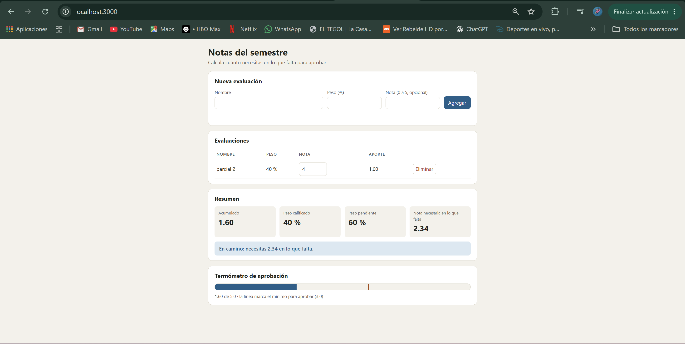

# Entrega · Laboratorio MVC · Notas del semestre

**Equipo:** ______________________  
**Integrantes:** ______________________  
**Repositorio:** ______________________

> Completa este archivo a medida que avanzas (cada sección dice en qué parte de la guía se llena).
> Escribe con tus palabras: las respuestas copiadas de la guía o de otro equipo no cuentan.

---

## 1. Mapa de responsabilidades (Parte 1)

Clasifica cada fragmento de `espagueti.html`: **M** (Modelo), **V** (Vista), **C** (Controlador) o **Mezcla**
(en ese caso, escribe qué roles se mezclan). En "¿Por qué?" justifica en una frase.


| # | Fragmento | Rol(es) | ¿Por qué? |
|---|---|---|---|
| 1 | `var n = document.getElementById('nombre').value.trim();` | V | Lee el nombre escrito por el usuario en el formulario. |
| 2 | Validación del peso entre 1 y 100 | Mezcla (M y V) | Valida el peso y muestra el mensaje de error en pantalla. |
| 3 | Validación de la suma de pesos | Mezcla (M y V) | Comprueba que no supere el 100 % y muestra el error. |
| 4 | `evals.push(...)` | M | Agrega una nueva evaluación a los datos. |
| 5 | `localStorage.setItem(...)` | M (Almacén) | Guarda las evaluaciones; en MVC se separó en almacen.js. |
| 6 | `document.getElementById('nombre').value = '';` | V | Limpia el campo del nombre en el formulario. |
| 7 | `input` con `onchange` | Mezcla (V y C) | Crea el campo de nota y conecta directamente un evento. |
| 8 | `Math.ceil(...)` | M | Redondea hacia arriba la nota necesaria para aprobar. |
| 9 | Condición de aprobado | Mezcla (M y V) | Decide si aprobó y define el mensaje y la clase visual. |
| 10 | `document.getElementById('tabla').innerHTML = filas;` | V | Actualiza la tabla que aparece en pantalla. |
| 11 | `function borrar(id)` | Mezcla (M, V y C) | Elimina datos, los guarda y actualiza la pantalla. |
| 12 | `(e.peso * e.nota / 100).toFixed(2)` | Mezcla (M y V) | Calcula el aporte y lo presenta con dos decimales. |


## 2. Olores del espagueti (Parte 1)

Lista **al menos 5** problemas de diseño de `espagueti.html`. Para cada uno, escribe qué consecuencia tiene
cuando el proyecto crece y en qué pieza de MVC viviría la solución.


| Olor | Consecuencia | Dónde se arregla (M, V o C) |
|---|---|---|
| Responsabilidades mezcladas | Las funciones hacen varias tareas al mismo tiempo, por lo que cualquier cambio puede afectar otras partes de la aplicación. | M, V y C: cada uno se encarga de su responsabilidad. |
| Validaciones dentro de la interfaz | Si cambian las reglas de las notas o los porcentajes, hay que buscar dónde están mezcladas con el código de pantalla. | M: las validaciones se centralizan en modelo.js. |
| Función pintar() con demasiadas tareas | Calcula las notas, decide el estado y actualiza la pantalla, lo que dificulta entenderla y mantenerla. | M para los cálculos y V para mostrar los resultados. |
| Almacenamiento mezclado con las acciones | Cambiar localStorage por otro tipo de almacenamiento obliga a modificar las funciones que gestionan las evaluaciones. | M con apoyo de almacen.js. |
| Eventos escritos directamente en el HTML | La interfaz queda muy relacionada con las funciones de JavaScript y es más difícil modificarla. | V para escuchar eventos y C para coordinar las acciones. |


## 3. El flujo de «agregar una evaluación» (Parte 6)

Dibuja (a mano y pega una foto, o con texto/Mermaid) el recorrido completo desde que el usuario presiona
**Agregar** hasta que ve la fila nueva en la tabla. Marca en cada paso **el archivo y el método** que actúa.

```text

1. Usuario
   Presiona el botón "Agregar".
          |
          v
2. vista.js → alAgregar()
   Detecta el envío del formulario.
          |
          v
3. vista.js → leerFormulario()
   Obtiene el nombre, peso y nota como texto.
          |
          v
4. controlador.js → constructor()
   Recibe los datos y convierte peso y nota.
          |
          v
5. controlador.js → #ejecutar()
   Solicita al Modelo agregar la evaluación.
          |
          v
6. modelo.js → agregar()
   Valida los datos y registra la evaluación.
          |
          v
7. modelo.js → #cambio()
   Guarda los datos y avisa a los suscriptores.
          |
          v
8. almacen.js → guardar()
   Conserva las evaluaciones en sessionStorage.
          |
          v
9. vista.js → render()
   Actualiza la tabla y el resumen académico.
          |
          v
10. termometro-vista.js → render()
    Actualiza la barra de aprobación.
          |
          v
11. Usuario
    Ve la nueva evaluación y el termómetro actualizado.

```

## 4. Evidencias (Partes 2, 3, 4 y 6)

**Salida de `npm test`** (pega el final, donde dice cuántas pruebas pasan):

```text
npm test               

> mvc-notas-lab@1.0.0 test
> node pruebas/ejecutar.mjs


MODELO
  ✓ A · Agregar y validar ......................... 11/11
  ✓ B · Calificar y eliminar ...................... 7/7
  ✓ C · Resumen ................................... 10/10
  ✓ D · Observador y persistencia ................. 8/8
  ✓ E · Parte 5A · Nombres únicos ................. 3/3

ARQUITECTURA
  ✓ Modelo puro ................................... 4/4
  ✓ Vista pasiva .................................. 5/5
  ✓ Controlador delgado ........................... 6/6

✓ 54 de 54 pruebas pasan.
```

**Salida de `npm run arquitectura`:**

```text
npm run arquitectura

> mvc-notas-lab@1.0.0 arquitectura
> node pruebas/ejecutar.mjs arquitectura


ARQUITECTURA
  ✓ Modelo puro ................................... 4/4
  ✓ Vista pasiva .................................. 5/5
  ✓ Controlador delgado ........................... 6/6

✓ 15 de 15 pruebas pasan.
```

**Captura de pantalla** de la aplicación con la tabla, el resumen y el termómetro de aprobación:




## 5. Tres cambios, tres lugares (Parte 5)

Después de cada cambio ejecuta `git diff --stat HEAD~1` (o `git show --stat`) y pega el resultado.
La idea: **cada cambio debía tocar solo las piezas que le corresponden**.

| Cambio | Archivos que tocaste | ¿Era lo esperado? ¿Por qué? |
|---|---|---|
| 5A · Nombres únicos | | |
| 5B · Segunda vista (termómetro) | | |
| 5C · Otro almacén | | |

## 6. Reflexión (Parte 6)

1. En la versión espagueti, ¿qué tuviste que leer o tocar para entender dónde se decide si el estudiante aprobó? ¿Y en la versión MVC?
2. ¿Por qué el Modelo **no** debe llamar a `alert()` ni a `document`? ¿Qué pasaría con las pruebas del Modelo si lo hiciera?
3. El Modelo avisa de sus cambios sin saber quién escucha (Observer). ¿Qué ganamos con eso frente a que el Modelo llame directamente a `vista.render()`?
4. Elige un olor de MVC (controlador gordo, lógica en la Vista, Modelo que toca la pantalla, Modelo anémico) que te hubiera sido fácil cometer hoy. ¿Cuál y cómo lo evitaron?
5. ¿Para qué tipo de aplicación **no** usarías MVC? Justifica con lo que viste en el laboratorio.
